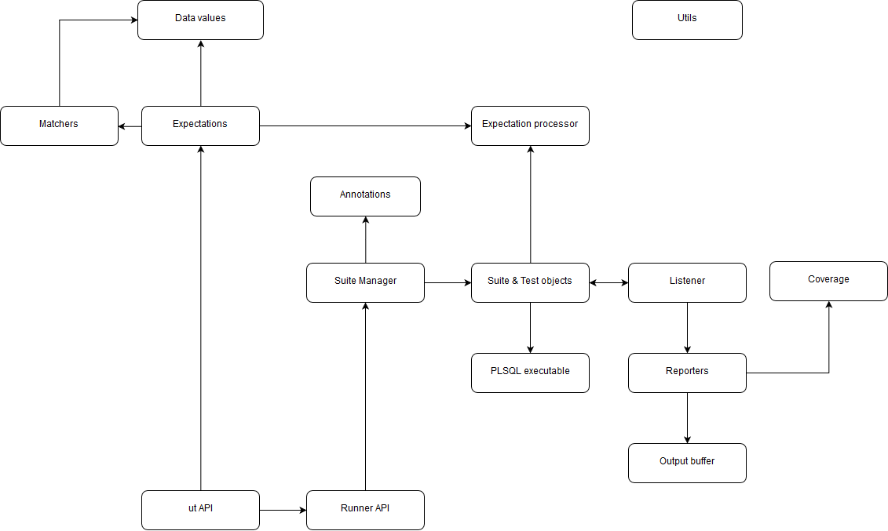

# How to contribute

The following are the guidelines everyone should use to contribute to utPLSQL.  
Changes are welcome from all members of the Community.  
Not able to contribute code? You can also support the project through [sponsorship](https://www.utplsql.org/sponsorship.html).

# Getting Started

1. Create a [GitHub Account](https://github.com/join).
2. Fork the utPLSQL Repository and setup your local Repository. _See [how to Fork](https://help.github.com/articles/fork-a-repo) article_
     * Each of the steps below are detailed in **Get started with development** section.
     * Clone your Fork to your local machine.
     * Configure "upstream" remote to the [utPLSQL repository](https://github.com/utPLSQL/utPLSQL.git).
3. For each change you want to make:
     * Make sure your forked repository is up to date with upstream before you start coding. See [syncing your local repository](https://help.github.com/articles/syncing-a-fork) with upstream utPLSQL repository.
     * Create a new branch for your change. We use `feature/feature_name` or `bugfix/fixed_issue_name` to identify branch types.
     * Make your change in your new branch.
     * Make sure your change is covered with unit tests.
     * **Verify code compiles and all existing and new unit tests pass.**
         * The quickest way to have a Pull Request not approved, is to submit code that does not compile or pass tests.
     * Commit change to your local repository.
     * Push change to your remote repository.
     * Submit a [Pull Request](https://help.github.com/articles/using-pull-requests) into develop branch.
     * Note: local and remote branches can be deleted after pull request has been merged.

# Coding Standards

* We use snake case for all identifiers in PLSQL code. This separates keywords in names with underscores.  `execute_test`
* All code is lower case.
* Prefixes:
	* Arguments to procedures and functions will start with `a_`, an Example would be procedure `is_valid(a_owner_name varchar2)`
	* Object types and packages will start with `ut_`
	* Local variables `l_`
	* Global variables `g_`
	* Global Constants start with `gc_`
	* Types in packages, objects start with `t_`
	* Nested Tables start with `tt_`
* varchar2 lengths are set in characters not bytes


# Configuring local environment

Your local environment can be of any flavor (Unix/Linux/Windows/Mac).
At minimum, you need to have Oracle database 19c accessible for the project and SYS account access to install and develop utPLSQL.

We use five different database accounts (users) for development process.
* `ut3` - holds latest released version of utPLSQL. This schema holds the testing framework used for self-testing of utPLSQL development.
* `ut3_develop` - holds the version of utPLSQL of your current branch. This is the schema you will be working on.
* `ut3_tester` - holds unit test packages for development of utPLSQL.
* `ut3_user` - used for testing accessibility to schema names with special characters.
* `ut3_tester_helper` - elevated privileges user, used for creating and dropping objects in other schemas during test run.

## Local database in a disposable Docker container

We use, and recommend, a disposable Docker container with Oracle Database Free, built from [gvenzl/oci-oracle-free](https://github.com/gvenzl/oci-oracle-free/tree/main), using image `gvenzl/oracle-free:slim-faststart`.
The container needs no setup and can be thrown away and recreated whenever you need a clean database.
`ORACLE_PASSWORD` sets the SYS password. Use the same value for `ORACLE_PWD` in `development/env.sh`, and connect to `127.0.0.1:1521/FREEPDB1`.

Run the container in background:
```bash
docker run -d --name utplsql-db -p 1521:1521 -e ORACLE_PASSWORD=oracle gvenzl/oracle-free:slim-faststart
```

Stop the container:
```bash
docker stop utplsql-db
```

Restart the container (database content is kept):
```bash
docker restart utplsql-db
```

Recreate the container (database content is lost):
```bash
docker rm -f utplsql-db && docker run -d --name utplsql-db -p 1521:1521 -e ORACLE_PASSWORD=oracle gvenzl/oracle-free:slim-faststart
```

The database is ready to use once `docker logs utplsql-db` shows `DATABASE IS READY TO USE!`.

## Get started with development

To get started with development, follow the below steps.

_If you're using Windows, run the shell scripts using `GIT bash` - Windows-based bash command line._

**Caution**: If you are using jetBrains DataGrip, don't use the integrated console to run the shell scripts (not even with GIT bash configured). It might disconnect from oracle randomly during script-run.

### Clone your fork of utPLSQL git repository

```bash
# clone your fork of utPLSQL
git clone https://github.com/your account/utPLSQL.git utPLSQL

cd utPLSQL

# add main project repo as upstream
git remote add upstream https://github.com/utPLSQL/utPLSQL.git

# fetch all remote repositories
git fetch --all
```

### Prepare environment script

Copy the environment variables template `development/template.env.sh` to `development/env.sh`
```bash
cp development/template.env.sh development/env.sh
chmod u+w development/env.sh
```

You might have to adjust the following lines in `development/env.sh`:
```bash
export SQLCLI=sql # For sqlcl client
#export SQLCLI=sqlplus # For sqlplus client
export CONNECTION_STR=127.0.0.1:1521/FREEPDB1 # Adjust the connect string
export ORACLE_PWD=oracle # Adjust your local SYS password
```

### Download utPLSQL release sources and utplsq-cli

The below script is fetching latest release version from utPLSQL repository. Latest release version is used for self-testing.
```bash
./development/refresh_sources.sh
```

### Setup local database for utPLSQL development

```bash
./development/install.sh
```

### That's it

You now have the following:
- sources from your fork of utPLSQL repository in `utPLSQL` directory
- sources from utPLSQL/utPLSQL repository (branch set by `SELFTESTING_BRANCH` in `development/env.sh`) in `utPLSQL/utPLSQL_latest_release` directory
- binaries of `utplsql-cli` in `utPLSQL/utPLSQL-cli` directory
- database users created
- your current branch of utPLSQL deployed into `ut3_develop` schema
- utPLSQL released version deployed into `ut3` schema

At any time, if you need to refresh your database, the below scripts might be helpful.

## Cleanup of utPLSQL installation in local database

```bash
development/cleanup.sh
```

## Reinstalling utPLSQL development in `ut3_develop` schema

```bash
development/refresh_ut3.sh
```

## Refreshing after release

Whenever a new version of utPLSQL or a new version of utPLSQL-cli is available, use `development/refresh_sources.sh` to refresh files in your local project folders.

## Running unit tests

utPLSQL v3 unit tests are located in the `test` directory

Before you push any changes and create a pull request to the utPLSQL project repository, make sure that all the tests are executing successfully in your local environment.

Every new functionality needs to be documented by unit tests that cover happy-path scenarios as well as edge-cases and exception paths.

> **Important notice:**
> We do our best to keep utPLSQL covered with unit tests.
> Lack of sufficient unit testing is a perfect reason for PR to be rejected.

To run a full suite of unit tests execute:
```bash
. ./development/env.sh
./test/install_and_run_tests.sh
```

You can review the results of tests as well as see information about code coverage in `./coverage.html` file.


## Modules

Below diagram gives a high-level overview of utPLSQL v3 modules and their dependencies.
Dependencies to `ut_util` are not shown as most of modules are depending on it.




## Build Environment

We are using a combination of private and publicly available docker images to test utPLSQL. The following versions of Oracle Database are used for testing:

* 19c-Standard Edition (private image)
* 21-free
* 23-free

The Free varsions are publicly available and you can set up your local development environment to use one of from [here](https://github.com/gvenzl/oci-oracle-free)

These [private image]((https://github.com/utPLSQL/docker-scripts) is a slimmed version of [the official Oracle database dockerfiles](https://github.com/oracle/docker-images/tree/master/OracleDatabase) . Due to licensing restrictions, the image cannot be public.

You can build your own and use it locally, or push to a private docker repository.
The build steps are simple if you already have some experience using Docker. You can find detailed information about how to build your own image with a running database in: [example of creating an image with pre-built DB](https://github.com/oracle/docker-images/blob/master/OracleDatabase/samples/prebuiltdb/README.md)

> If you are new to Docker, you can start by reading the [Getting Started With Docker](https://docs.docker.com/get-started/) docs.

## New to GIT

If you are new to GIT here are some links to help you with understanding how it works.    

- [GIT Documentation](http://git-scm.com/doc)
- [Atlassian Git Tutorial](https://www.atlassian.com/git/tutorial/git-basics)
- [What are other resources for learning Git and GitHub](https://help.github.com/articles/what-are-other-good-resources-for-learning-git-and-github)
